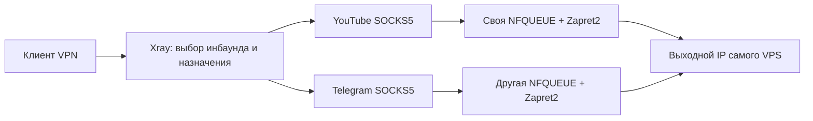

# Forcus Zapret Manager

Установка и управление двумя независимыми профилями **YouTube** и **Telegram** на Linux VPS. Менеджер скачивает проверенную версию Zapret2, устанавливает зависимости, поднимает локальные SOCKS5, создаёт собственные правила nftables и службы systemd. Для Xray/3x-ui предусмотрена автоматическая привязка к выбранным инбаундам с резервной копией и откатом при ошибке.

Меню по подходу похоже на [Forcus Psiphon Auto Pin Manager](https://github.com/Forcus356/Psiphon-Auto-Pin-Manager). Сетевая схема повторяет настроенный и проверенный на российском VPS вариант Dante + Zapret2.

## Быстрый запуск

Требования: **Ubuntu 22.04+/Debian 12+, x86_64, Python 3.10+, systemd, root и доступ в интернет**. Основная проверка установки выполнена на Ubuntu 24.04. Для автоматической интеграции нужен уже установленный Xray; сам VPN-вход, сертификаты и панель создаются отдельно.

Скачай из архива или репозитория файл `install_forcus_zapret.sh` и запусти:

```bash
sudo bash ./install_forcus_zapret.sh
```

Откроется русскоязычное меню. Выбери:

1. **Установить профили** → **Оба профиля**.
2. Интерфейс — `auto`, дополнительные настройки по желанию.
3. Для Telegram — режим порта `auto`.
4. Подтверди установку. После неё мастер предложит подключить выбранные профили к Xray.
5. Выбери нужные инбаунды отдельно для YouTube и Telegram и подтверди показанный список.

Вернуться в меню:

```bash
sudo forcus-zapret
```

Установщик автономный: в нём уже находится исходный Python-код менеджера. Во время установки из интернета загружаются пакеты ОС и официальный release-архив Zapret2, сверяемый по SHA256. Рядом лежащие файлы проекта для запуска установщика не требуются.

## Два профиля

| Параметр | YouTube | Telegram |
|---|---|---|
| SOCKS по умолчанию | `127.0.0.1:10808` | `127.0.0.1:10809` |
| Очередь по умолчанию | 200 | 201 |
| Пользователь | `fzm-yt` | `fzm-tg` |
| Таблица nftables | `inet fzm_youtube` | `inet fzm_telegram` |
| Обработка | TLS ClientHello YouTube, fake + multisplit | TLS и MTProto/unknown; UDP passthrough |
| Привязка Xray | выбранные инбаунды | отдельно выбранные инбаунды |

При занятых стандартных портах и очередях автоматически выбираются свободные. Если порт или очередь заданы явно и заняты, установка останавливается. Существующий профиль при повторной установке сохраняет настройки и не дублируется.



**Выходной IP — IP самого VPS.** Для российского выхода нужен VPS в России. Выбор страны и поиск зарубежного туннеля в эту схему не входят.

## Установка через CLI

Оба профиля с автоматическим выбором ресурсов:

```bash
sudo bash ./install_forcus_zapret.sh install --profile both --yes
```

По отдельности, со своими портами и очередями:

```bash
sudo bash ./install_forcus_zapret.sh install \
  --profile youtube --port 10808 --queue 200 --interface ens3 --yes

sudo forcus-zapret install \
  --profile telegram --port 10809 --queue 201 --interface ens3 \
  --telegram-port-mode auto --yes
```

`--port` и `--queue` разрешены при установке одного профиля. Для разных профилей нужны разные порты и очереди. В режиме `both` используй автоматический выбор или две отдельные команды.

Установка системных пакетов выполняется через apt. Системный Python и уже настроенный Dante не заменяются. Если пакет Dante устанавливается впервые и его штатной службы/конфига раньше не было, пустая штатная служба отключается: менеджер использует две собственные службы.

## Особенность Telegram: порт 5222

На исходном российском VPS TCP/443 и TCP/80 к проверенным Telegram DC не открывались, а у DC2 и DC4 работал порт 5222. Одного изменения доменного списка в этой ситуации недостаточно.

Режимы:

| Режим | Поведение |
|---|---|
| `auto` | Проверяет TCP/443 и TCP/5222 у двух контрольных DC. Включает перевод, если 443 недоступен, а 5222 доступен хотя бы у одного. Наблюдения сохраняются. |
| `off` | Сохраняет исходные порты Telegram. |
| `5222` | Включает перевод подходящих MTProto-соединений принудительно. |

При включённом переводе Xray сохраняет исходный IP Telegram и меняет порт TCP 80/443 на 5222 через `freedom redirect` и локальный SOCKS. Перед этими правилами стоят исключения для распознанного HTTP/TLS. Остальной TCP и UDP направляется в Telegram SOCKS с исходными портами.

Проверка `auto` — первоначальная эвристика доступности портов, а не гарантия работы любого аккаунта или всех DC. Некоторым серверам Telegram 5222 недоступен. Команда `check` показывает фактические ответы каждого из пяти контрольных DC, включая частичный результат.

UDP проходит через отдельную очередь без UDP-десинхронизации. Голосовые/видеозвонки и произвольные P2P-адреса требуют отдельной проверки на устройстве; доменный/IP-список Telegram не определяет любой произвольный IP собеседника.

## Привязка к Xray / 3x-ui

Автоматическое применение поддерживает:

- PostgreSQL: таблица `settings`, ключ `xrayTemplateConfig`.
- SQLite: тот же ключ в БД 3x-ui.
- Standalone Xray: настоящий постоянный JSON-конфиг.

Нужно локальное gRPC API Xray с **HandlerService и RoutingService**. По умолчанию используется `127.0.0.1:62789`. Оно должно быть уже включено в установленной версии ядра. Если API или проверка конфига не проходят, менеджер выдаёт ошибку, сохраняя работающие профили. JSON можно подготовить для ручного применения через панель.

Пример для исходной схемы Forcus: Telegram **только** в «Россия» и «Россия YT без рекламы»; YouTube также в двух зарубежных профилях с российским YouTube:

```bash
sudo forcus-zapret xray apply \
  --backend auto \
  --youtube-inbounds in-10443-tcp,in-20443-tcp,in-50443-tcp,in-60443-tcp \
  --telegram-inbounds in-10443-tcp,in-20443-tcp \
  --yes
```

Это пример тегов исходного сервера. На другой машине выбери свои реальные `inboundTag`. Менеджер не выбирает все инбаунды автоматически.

Явный PostgreSQL:

```bash
sudo forcus-zapret xray apply \
  --backend postgres --database xui --pg-user postgres \
  --telegram-inbounds in-10443-tcp,in-20443-tcp \
  --api 127.0.0.1:62789 --yes
```

Явный SQLite:

```bash
sudo forcus-zapret xray apply \
  --backend sqlite --config /etc/x-ui/x-ui.db \
  --youtube-inbounds my-ru-inbound --yes
```

Standalone:

```bash
sudo forcus-zapret xray apply \
  --backend standalone --config /usr/local/etc/xray/config.json \
  --runtime /usr/local/etc/xray/config.json --binary /usr/local/bin/xray \
  --api 127.0.0.1:62789 --youtube-inbounds my-ru-inbound --yes
```

В режиме `standalone` нельзя выдавать сгенерированный `/usr/local/x-ui/bin/config.json` за постоянное хранилище панели.

Применение выполняется так: резервная копия → проверка полного конфига Xray → добавление новых outbounds → применение полного routing → атомарная проверка и запись постоянного шаблона → сохранение runtime. При параллельном изменении шаблона чужое значение не перезаписывается. При ошибке менеджер возвращает прежние правила и удаляет добавленные им обработчики; неполный откат сообщается отдельно.

Существующие пользовательские правила/выходы сохраняются. Новые правила вставляются после начальных служебных правил API, запрета private IP и исключения gstatic. Для сложной маршрутизации можно указать `--insert-at N` — индекс позиции вставки. Просмотри порядок: первое совпадение выигрывает.

Подготовить JSON без применения:

```bash
sudo forcus-zapret xray show --telegram-inbounds my-ru-inbound

sudo forcus-zapret xray prepare \
  --input /root/xray-before.json --output /root/xray-with-zapret.json \
  --telegram-inbounds my-ru-inbound
```

`show` выдаёт фрагменты, `prepare` — новый полный конфиг. В полный конфиг попадают прежние клиентские данные: храни его с закрытыми правами.

## Проверки и операции

```bash
sudo forcus-zapret status --profile all
sudo forcus-zapret check --profile all
sudo forcus-zapret logs --profile telegram --lines 80
sudo forcus-zapret restart --profile youtube --yes
sudo forcus-zapret stop --profile telegram --yes
sudo forcus-zapret start --profile telegram --yes
sudo forcus-zapret backup --output /root/forcus-zapret-backup.tar.gz
```

`status` отдельно показывает активность служб, автозапуск, SOCKS-порт, очередь, состояние привязки и сохранённый результат последней проверки.

`check` сравнивает IP VPS и SOCKS. Для YouTube проверяет HTTPS-доступность страницы; это не тест скорости видеопотока. Для Telegram отправляет неавторизованный MTProto `req_pq_multi` и проверяет ответ `resPQ` с тем же nonce. Вход в аккаунт, чтение переписки и отправка сообщений не выполняются.

Проверка через SOCKS подтверждает прокси-часть цепочки. Для окончательной проверки выбери нужный VPN-профиль на телефоне, переподключись и проверь длинное видео / сообщения / медиа / звонок.

## Обновление Zapret2

Установка закреплена на **v1.0.7** с SHA256:

```text
547a5dce3f4820721a425680ea3f7f3971b7e9c772b8c795dd2d623148da0928
```

Проверить и применить известную версию:

```bash
sudo forcus-zapret update-engine --yes
```

Для другой версии передай её номер и SHA256 официального `zapret2-vX.Y.Z.tar.gz`:

```text
forcus-zapret update-engine --engine-version vX.Y.Z --sha256 SHA256_ОФИЦИАЛЬНОГО_АРХИВА --yes
```

Новый движок сначала скачивается и проверяется со всеми установленными профилями через `--dry-run`. Только затем перезапускаются DPI-службы. При ошибке запуска восстанавливаются прежние unit-файлы. Старые версии движка сохраняются до полного удаления менеджера. Менеджер не обещает автоматический подбор стратегии под любого провайдера.

## Удаление и откат

Сначала отключи привязку к Xray, затем удали профиль:

```bash
sudo forcus-zapret xray detach --profile telegram --yes
sudo forcus-zapret remove --profile telegram --yes
```

Удалить всё:

```bash
sudo forcus-zapret xray detach --profile all --yes
sudo forcus-zapret uninstall --yes
```

Удаление останавливается, если профиль ещё зарегистрирован в привязке или пользовательское правило/outbound ссылается на его SOCKS. Удаляются только собственные службы, файлы и помеченные таблицы. Системные пакеты и резервные копии сохраняются. Полный firewall не очищается.

Защита привязок относится к настройкам, зарегистрированным через `xray apply`; при `detach` также проверяются оставшиеся ссылки в этом шаблоне. Если SOCKS вручную добавлен в другую программу или другой конфиг, сначала отключи его там самостоятельно. После полного удаления текущее глобальное значение conntrack accounting намеренно не обнуляется.

## Файлы и совместимость с ручной установкой

| Путь | Содержимое |
|---|---|
| `/opt/forcus-zapret/` | код и проверенные версии движка |
| `/etc/forcus-zapret/state.json` | профили, привязки и результаты проверок; root-only |
| `/etc/forcus-zapret/*.danted.conf` | независимые Dante-конфиги |
| `/etc/forcus-zapret/*.nft` | собственные таблицы nftables |
| `/etc/systemd/system/forcus-zapret-*.service` | службы двух профилей |
| `/var/cache/forcus-zapret/` | проверенные release-архивы |
| `/var/backups/forcus-zapret/` | копии до изменений и шаблоны Xray до/после |

Существующая ручная установка с `zapret_dante` / `forcus_telegram` и службами `forcus-youtube-*` / `forcus-telegram-*` сохраняется. Новые имена, пользователи и таблицы отличаются; занятые порты/очереди будут обойдены. Миграция Xray требует явного выбора новых привязок; удаление старой ручной установки выполняется отдельно после проверки.

SOCKS слушает только `127.0.0.1`. Xray в Docker должен находиться в том же сетевом пространстве для использования этого адреса. Для bridge-схемы с другим адресом нужен отдельный проект настройки доступа; открывать SOCKS без пароля на публичном интерфейсе нельзя.

В Dante отдельно запрещены TCP-подключения к loopback, частным, link-local и другим служебным сетям. Профили предназначены для внешних сервисов. Это сохраняет защиту локальных административных портов и при маршрутизации через SOCKS. UDP ASSOCIATE остаётся доступен; тесты звонков по-прежнему выполняются отдельно.

Правила nftables используют `meta l4proto`, охватывая IPv4 и IPv6. Для IPv6 также нужен работающий внешний IPv6-маршрут VPS. Устройства и провайдеры могут вести себя по-разному — проверка сервиса отделена от запуска процессов.

## Разработка и тесты

```bash
python3 -m unittest discover -s tests -v
python3 build_installer.py
bash -n install_forcus_zapret.sh
```

`tests/Dockerfile.systemd` и `tests/container_smoke.py` предназначены для отдельного контейнера с systemd/NFQUEUE. Smoke-тест дополнительно использует настоящий Xray и geodata, проверяет горячую привязку к SQLite/standalone/PostgreSQL, неизменность процесса ядра, повторное применение и отключение привязок. Не запускай `container_smoke.py` на настоящем VPS.

Результаты испытаний и их границы: [TESTING.md](TESTING.md).

Инсталлятор собирается из `forcus_zapret.py`; после изменения Python-кода перегенерируй его. Скрипт не публикует изменения в GitHub сам.

## Источники

- [Официальный Zapret2 v1.0.7](https://github.com/bol-van/zapret2/releases/tag/v1.0.7)
- [Мануал Zapret2](https://github.com/bol-van/zapret2/blob/v1.0.7/docs/manual.md)
- [Dante](https://www.inet.no/dante/)
- [Xray Routing](https://xtls.github.io/en/config/routing.html)
- [Xray Freedom redirect](https://xtls.github.io/en/config/outbounds/freedom.html)
- [Транспорты Telegram](https://core.telegram.org/mtproto/transports)
- [Официальные CIDR Telegram](https://core.telegram.org/resources/cidr.txt)

Лицензия менеджера: GPL-3.0-or-later. Сведения о компонентах: [THIRD_PARTY_NOTICES.md](THIRD_PARTY_NOTICES.md).
