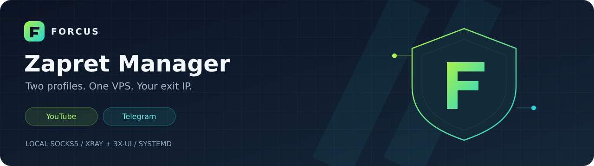
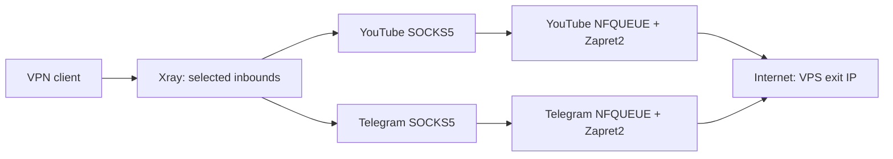
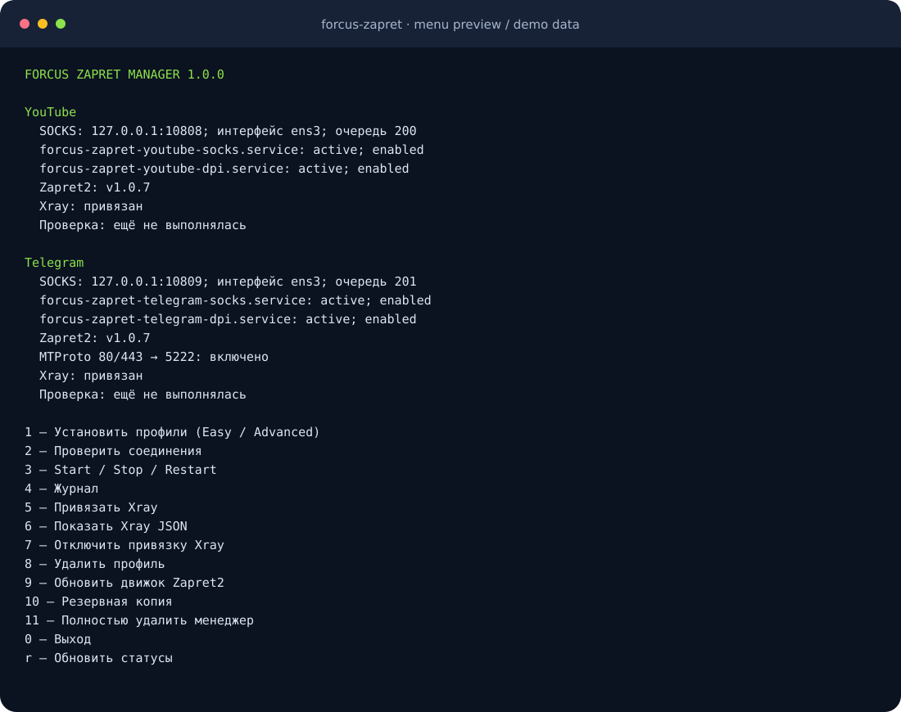

<p align="center"></p>

<p align="center">
  
  
  
  <a href="LICENSE"></a>
</p>

<h1 align="center">Forcus Zapret Manager</h1>
<p align="center"><strong>Local SOCKS5 · YouTube + Telegram · Xray / 3x-ui · systemd</strong></p>
<p align="center">English · <a href="README.ru_RU.md">Русский</a></p>

A console manager for two independent **YouTube** and **Telegram** profiles on a Linux VPS. It installs Dante and a checksum-verified Zapret2 engine, creates per-profile services and packet queues, and can connect selected Xray inbounds to the profiles.

**Traffic exits through your VPS IP.** For a Russian exit, use a VPS in Russia. The manager does not select a country or establish a foreign tunnel.

[Quick start](#quick-start) · [Features](#features) · [Menu](#console-menu) · [Xray](#xray--3x-ui) · [Commands](#command-reference) · [Docs](docs/README.md) · [FAQ](docs/faq.md)

## Quick start

Run in **Bash as root**, or use `sudo` as shown. Requirements: **Ubuntu 22.04+ / Debian 12+, x86_64, systemd, Python 3.10+**, Internet access and a kernel with nftables/NFQUEUE support. Ubuntu 24.04 is the installation-tested environment. Install `curl` first if it is missing.

```bash
curl -fsSL https://raw.githubusercontent.com/Forcus356/Zapret-Manager/main/install_forcus_zapret.sh -o /tmp/install_forcus_zapret.sh && sudo bash /tmp/install_forcus_zapret.sh
```

The installer is self-contained: no clone or pip dependencies are needed. After confirmation, it downloads missing OS packages and the pinned Zapret2 release.

In the Russian-language menu:

1. Select **1 — Установить профили**, then **3 — Оба профиля**.
2. Keep the interface and Telegram port mode on `auto` to start.
3. Confirm installation, then choose whether to connect the profiles to Xray.
4. Select the actual inbounds separately for YouTube and Telegram, review and confirm.

Reopen the menu after installation:

```bash
sudo forcus-zapret
```

Xray, its inbound listeners, certificates and panel must already exist for automatic integration. Installing the profiles alone does not change Xray routing.

## Features

- Two independent profiles: separate SOCKS ports, service users, systemd services and NFQUEUE numbers.
- Automatic selection of free ports and queues; explicit conflicting values are rejected.
- Dante + Zapret2 with the VPS's own outgoing IP.
- Telegram domain/IP routing and optional MTProto port translation to `5222`.
- Xray integration with SQLite / PostgreSQL 3x-ui templates or a standalone JSON config.
- Explicit inbound selection, backups, configuration validation and rollback on apply failure.
- Status, connection checks, logs, start/stop/restart, engine updates and uninstall from one menu.
- Loopback-only SOCKS and separate nftables tables; no full firewall flush.

## Two profiles, one VPS

| | YouTube | Telegram |
|---|---|---|
| Default SOCKS5 | `127.0.0.1:10808` | `127.0.0.1:10809` |
| Default NFQUEUE | `200` | `201` |
| Service user | `fzm-yt` | `fzm-tg` |
| nftables table | `inet fzm_youtube` | `inet fzm_telegram` |
| Traffic handling | TLS strategy: fake + multisplit | TLS / MTProto; UDP passthrough |
| Xray scope | Selected inbounds | Separately selected inbounds |

Ports and queues are defaults. If occupied, alternatives are selected; use `status` for actual endpoints.



YouTube routing blocks matching UDP/443 on the selected inbounds so clients can fall back to TCP. Telegram UDP passes through without UDP desynchronization; calls need a separate device test.

## Console menu

The interface currently uses **Russian labels**. Commands and flags are the same in both guides.

<p align="center"></p>

*Illustrative menu output with demonstration profile state; not a live VPS screenshot.* [Text version](docs/assets/menu-demo.txt).

The menu covers installation, checks, services, logs, Xray binding, JSON export, detach, profile removal, engine updates, backups and full removal. Press `r` to refresh saved status; use **2 — Проверить соединения** for new probes.

## Installation examples

Both profiles, without the wizard:

```bash
sudo bash /tmp/install_forcus_zapret.sh install --profile both --yes
```

YouTube with explicit resources, then Telegram:

```bash
sudo bash /tmp/install_forcus_zapret.sh install \
  --profile youtube --port 10808 --queue 200 --interface ens3 --yes

sudo forcus-zapret install \
  --profile telegram --port 10809 --queue 201 --interface ens3 \
  --telegram-port-mode auto --yes
```

Replace `ens3` with your interface, or omit `--interface` for automatic detection. `--port` and `--queue` require a single profile; do not use them with `--profile both`.

| Installation option | Default | Meaning |
|---|---|---|
| `--profile youtube\|telegram\|both` | `both` | Profiles to install |
| `--interface NAME` | auto | Outgoing interface |
| `--port N` | free port | SOCKS listener; one profile only |
| `--queue N` | free queue | NFQUEUE; one profile only |
| `--telegram-port-mode auto\|off\|5222` | `auto` | Telegram port translation policy |
| `--yes` | confirmation prompt | Confirm the requested CLI operation |

Existing profile settings are retained on repeated installation. [Installation and compatibility →](docs/installation.md)

## Xray / 3x-ui

The manager persists routing to **SQLite / PostgreSQL panel templates** or **standalone JSON**. Hot apply requires the existing Xray local API with **HandlerService + RoutingService**, normally `127.0.0.1:62789`, a usable runtime config and the Xray binary. Referenced geodata must be available to Xray.

For example, route YouTube from `ru-main` and `ru-youtube`, but Telegram only from `ru-main`:

```bash
sudo forcus-zapret xray apply \
  --backend auto \
  --youtube-inbounds ru-main,ru-youtube \
  --telegram-inbounds ru-main \
  --yes
```

**Replace example tags with existing `inboundTag` values.** All inbounds are not selected automatically. The operation backs up and validates the config, applies routing and persists the template; failures trigger rollback, with incomplete rollback reported separately.

Export a fragment for manual integration without applying it:

```bash
sudo forcus-zapret xray show \
  --youtube-inbounds ru-main --telegram-inbounds ru-main
```

`127.0.0.1` must refer to the same network namespace for Xray and Dante. For Xray in Docker, use host networking for this layout. Do not expose the unauthenticated SOCKS listener publicly.

[Backend examples, routing order, sniffing and JSON fragments →](docs/xray/README.md)

## Command reference

| Command | Purpose |
|---|---|
| `sudo forcus-zapret` | Open the menu |
| `sudo forcus-zapret status --profile all` | Services, ports, bindings and saved checks |
| `sudo forcus-zapret check --profile all` | Fresh connection probes |
| `sudo forcus-zapret logs --profile telegram --lines 80` | Recent SOCKS/DPI logs |
| `sudo forcus-zapret start --profile telegram --yes` | Start a profile |
| `sudo forcus-zapret stop --profile telegram --yes` | Stop a profile |
| `sudo forcus-zapret restart --profile youtube --yes` | Restart a profile |
| `sudo forcus-zapret xray show --youtube-inbounds ru-main` | Export routing fragments |
| `sudo forcus-zapret update-engine --yes` | Verify/apply the default pinned Zapret2 engine |
| `sudo forcus-zapret backup --output /root/forcus-zapret-backup.tar.gz` | Export a backup |
| `sudo forcus-zapret xray detach --profile telegram --yes` | Remove a managed Xray binding |
| `sudo forcus-zapret remove --profile telegram --yes` | Remove a detached profile |
| `sudo forcus-zapret --help` | CLI help |

`install` accepts `both`; lifecycle commands accept `all`. [Updates, backups, paths and diagnostics →](docs/operations.md)

## Telegram port mode

| Mode | Behavior |
|---|---|
| `auto` | Probe TCP/443 and TCP/5222 on two control DCs; enable translation when 443 fails but 5222 works for at least one |
| `off` | Preserve original ports |
| `5222` | Force eligible MTProto TCP/80 and TCP/443 connections to port 5222 |

The destination IP is preserved. Recognized TLS/HTTP is excluded from translation. `auto` is a reachability heuristic, not proof that every DC or call works. [Details →](docs/installation.md#telegram-port-mode)

## Checks and expected results

`check` compares direct and SOCKS public IPs. YouTube checks HTTPS page reachability. Telegram checks an unauthenticated MTProto response and its nonce across five control DCs, without logging into an account or accessing messages.

**Active services are not a video speed test.** Verify long videos and Telegram messages/media on a device through the intended inbound. Provider-specific strategies and arbitrary P2P call destinations may require additional work.

Release 1.0.0 has a recorded run of **45 unit tests**, plus isolated Ubuntu 24.04 systemd/NFQUEUE integration checks with real Xray, SQLite and PostgreSQL. These are release results, not a claim that GitHub Actions has already run. [Evidence and limits →](docs/testing.md)

## Uninstall

Detach managed routing before removal:

```bash
sudo forcus-zapret xray detach --profile all --yes
sudo forcus-zapret uninstall --yes
```

To remove Telegram only, use `xray detach --profile telegram --yes`, then `remove --profile telegram --yes`.

Removal is refused while recorded bindings or detected references use a profile. Manually configured consumers outside the managed config must be detached separately. System packages, backups and unrelated firewall tables are retained.

## Documentation and development

| | |
|---|---|
| [Documentation index](docs/README.md) | Installation, operations and troubleshooting; detailed guides are in Russian |
| [Xray examples](docs/xray/README.md) | Backends and generated JSON fragments |
| [Test suite](tests/README.md) | Unit tests and isolated integration scenarios |
| [Testing report](docs/testing.md) | Verified behavior and device/provider-dependent limits |
| [Security](SECURITY.md) | Exposure model and vulnerability reporting |
| [Changelog](CHANGELOG.md) | Release history |
| [Third-party notices](THIRD_PARTY_NOTICES.md) | Components and upstream projects |

From a source checkout, no root privileges are needed for unit tests or builds:

```bash
python3 -m unittest discover -s tests -v
python3 build_installer.py
bash -n install_forcus_zapret.sh
python3 build_release.py
```

The standalone installer is generated from `forcus_zapret.py`; rebuild after source changes. `.github/workflows/checks.yml` runs unit tests and verifies the build without installing production VPS services.

Built with [Zapret2](https://github.com/bol-van/zapret2), [Dante](https://www.inet.no/dante/) and [Xray](https://github.com/XTLS/Xray-core). Console workflow inspired by [Forcus Auto-Pin](https://github.com/Forcus356/Psiphon-Auto-Pin-Manager).

Licensed under [GPL-3.0-or-later](LICENSE).
