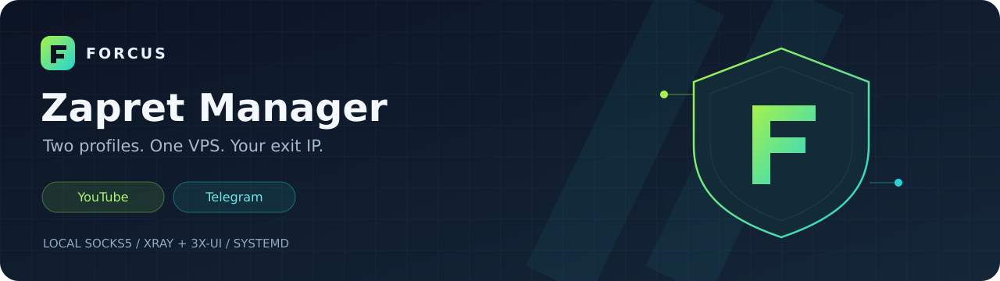
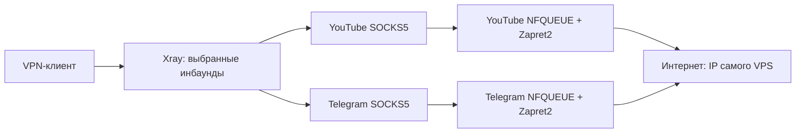
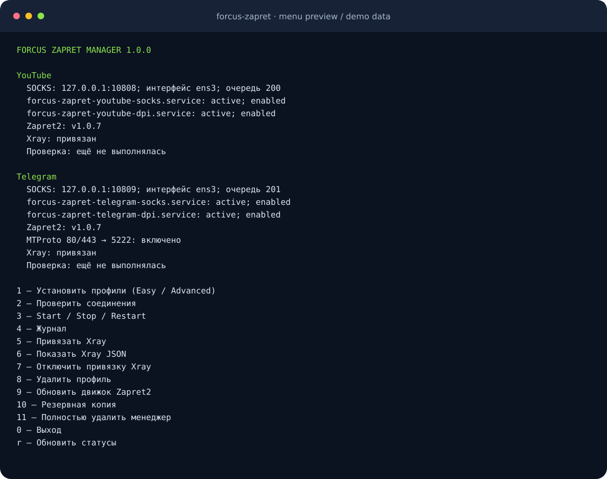

<p align="center"></p>

<p align="center">
  
  
  
  <a href="LICENSE"></a>
</p>

<h1 align="center">Forcus Zapret Manager</h1>
<p align="center"><strong>Локальные SOCKS5 · YouTube + Telegram · Xray / 3x-ui · systemd</strong></p>
<p align="center"><a href="README.md">English</a> · Русский</p>

Консольный менеджер двух независимых профилей **YouTube** и **Telegram** на Linux VPS. Сам устанавливает Dante и проверенный по SHA256 движок Zapret2, создаёт отдельные службы и очереди обработки пакетов, а затем позволяет подключить к ним выбранные инбаунды Xray.

**Выходной IP — IP самого VPS.** Для российского выхода нужен сервер в России. Менеджер не выбирает страну и не создаёт зарубежный туннель.

[Быстрый старт](#быстрый-старт) · [Возможности](#возможности) · [Меню](#консольное-меню) · [Xray](#xray--3x-ui) · [Команды](#все-команды) · [Документация](docs/README.md) · [FAQ](docs/faq.md)

## Быстрый старт

Запускай в **Bash от root** или через `sudo`, как в примере. Требования: **Ubuntu 22.04+ / Debian 12+, x86_64, systemd, Python 3.10+**, доступ в интернет и поддержка nftables/NFQUEUE в ядре. Реальная установка проверена на Ubuntu 24.04. Если `curl` отсутствует, сначала установи его.

```bash
curl -fsSL https://raw.githubusercontent.com/Forcus356/Zapret-Manager/main/install_forcus_zapret.sh -o /tmp/install_forcus_zapret.sh && sudo bash /tmp/install_forcus_zapret.sh
```

Установщик автономный: клонировать репозиторий и устанавливать Python-пакеты через pip не требуется. После подтверждения он скачает недостающие системные пакеты и закреплённую версию Zapret2.

В меню:

1. Выбери **1 — Установить профили**, затем **3 — Оба профиля**.
2. Для начала оставь интерфейс и режим порта Telegram на `auto`.
3. Подтверди установку, затем выбери, подключать ли профили к Xray.
4. Отдельно укажи реальные инбаунды для YouTube и Telegram, проверь список и подтверди.

Вернуться в меню после установки:

```bash
sudo forcus-zapret
```

Для автоматической интеграции Xray, его инбаунды, сертификаты и панель должны быть настроены заранее. Установка самих профилей ещё не меняет маршрутизацию Xray.

## Возможности

- Два независимых профиля со своими SOCKS-портами, пользователями, службами systemd и NFQUEUE.
- Автоматический выбор свободных портов и очередей; отказ при конфликте явно заданных значений.
- Dante + Zapret2 с сохранением выходного IP сервера.
- Telegram по доменам и IP, опциональный перевод MTProto на порт `5222`.
- Интеграция с шаблоном 3x-ui в SQLite / PostgreSQL или постоянным JSON-конфигом Xray.
- Явный выбор инбаундов, резервные копии, проверка конфига и откат при ошибке применения.
- Проверки соединения, журналы, запуск/остановка, обновление движка и удаление из одного меню.
- SOCKS только на loopback и собственные таблицы nftables без очистки общего firewall.

## Два профиля на одном сервере

| | YouTube | Telegram |
|---|---|---|
| SOCKS5 по умолчанию | `127.0.0.1:10808` | `127.0.0.1:10809` |
| NFQUEUE по умолчанию | `200` | `201` |
| Пользователь | `fzm-yt` | `fzm-tg` |
| Таблица nftables | `inet fzm_youtube` | `inet fzm_telegram` |
| Обработка | TLS: fake + multisplit | TLS / MTProto; UDP passthrough |
| Область Xray | Выбранные инбаунды | Отдельно выбранные инбаунды |

Если начальные порты и очереди заняты, менеджер подберёт свободные. Фактические адреса смотри через `status`.



Для YouTube правила блокируют подходящий UDP/443 на выбранных инбаундах, позволяя приложениям перейти на TCP. UDP Telegram проходит без UDP-десинхронизации; звонки проверяются отдельно на устройстве.

## Консольное меню

Интерфейс на **русском языке**. CLI-команды одинаковы для обеих версий инструкции.

<p align="center"></p>

*Иллюстрация вывода меню с демонстрационным состоянием профилей; не снимок рабочего сервера.* [Текстовая версия](docs/assets/menu-demo.txt).

Из меню доступны установка, проверки, управление службами, журналы, привязка Xray, экспорт JSON, отключение привязок, удаление профилей, обновление Zapret2 и резервные копии. `r` обновляет показ сохранённого состояния; **2 — Проверить соединения** запускает новые проверки.

## Примеры установки

Два профиля без мастера:

```bash
sudo bash /tmp/install_forcus_zapret.sh install --profile both --yes
```

YouTube со своими ресурсами, затем Telegram:

```bash
sudo bash /tmp/install_forcus_zapret.sh install \
  --profile youtube --port 10808 --queue 200 --interface ens3 --yes

sudo forcus-zapret install \
  --profile telegram --port 10809 --queue 201 --interface ens3 \
  --telegram-port-mode auto --yes
```

Замени `ens3` на свой интерфейс или убери `--interface` для автоопределения. `--port` и `--queue` задаются только для одного профиля; с `--profile both` их использовать нельзя.

| Параметр установки | По умолчанию | Назначение |
|---|---|---|
| `--profile youtube\|telegram\|both` | `both` | Устанавливаемые профили |
| `--interface NAME` | auto | Исходящий интерфейс |
| `--port N` | свободный порт | SOCKS; только для одного профиля |
| `--queue N` | свободная очередь | NFQUEUE; только для одного профиля |
| `--telegram-port-mode auto\|off\|5222` | `auto` | Режим перевода портов Telegram |
| `--yes` | запрос подтверждения | Подтвердить выбранную CLI-операцию |

Повторная установка сохраняет настройки существующего профиля. [Подробности установки и совместимости →](docs/installation.md)

## Xray / 3x-ui

Менеджер сохраняет маршрутизацию в **шаблон панели SQLite / PostgreSQL** или **постоянный JSON-конфиг Xray**. Для горячего применения нужны уже включённое локальное API Xray с **HandlerService + RoutingService**, обычно `127.0.0.1:62789`, действующий runtime-конфиг и бинарник Xray. Используемые geodata должны быть доступны ядру.

Например, YouTube через `ru-main` и `ru-youtube`, а Telegram — только через `ru-main`:

```bash
sudo forcus-zapret xray apply \
  --backend auto \
  --youtube-inbounds ru-main,ru-youtube \
  --telegram-inbounds ru-main \
  --yes
```

**Замени теги примера на существующие `inboundTag` своего сервера.** Все входы автоматически не выбираются. Перед применением создаётся копия и проверяется конфиг; затем меняется маршрутизация и сохраняется шаблон панели. При ошибке выполняется откат, неполный откат сообщается отдельно.

Для ручного подключения можно вывести фрагмент без применения:

```bash
sudo forcus-zapret xray show \
  --youtube-inbounds ru-main --telegram-inbounds ru-main
```

Для Xray и Dante адрес `127.0.0.1` должен относиться к одному сетевому пространству. В этой схеме для Xray в Docker нужен host networking. Не открывай SOCKS без авторизации на публичный интерфейс.

[Примеры backend, порядок правил, sniffing и JSON-фрагменты →](docs/xray/README.md)

## Все команды

| Команда | Назначение |
|---|---|
| `sudo forcus-zapret` | Открыть меню |
| `sudo forcus-zapret status --profile all` | Службы, порты, привязки и сохранённые проверки |
| `sudo forcus-zapret check --profile all` | Проверить соединения сейчас |
| `sudo forcus-zapret logs --profile telegram --lines 80` | Последние журналы SOCKS/DPI |
| `sudo forcus-zapret start --profile telegram --yes` | Запустить профиль |
| `sudo forcus-zapret stop --profile telegram --yes` | Остановить профиль |
| `sudo forcus-zapret restart --profile youtube --yes` | Перезапустить профиль |
| `sudo forcus-zapret xray show --youtube-inbounds ru-main` | Вывести фрагменты маршрутизации |
| `sudo forcus-zapret update-engine --yes` | Проверить/применить закреплённый движок Zapret2 |
| `sudo forcus-zapret backup --output /root/forcus-zapret-backup.tar.gz` | Экспортировать резервную копию |
| `sudo forcus-zapret xray detach --profile telegram --yes` | Отключить привязку Xray |
| `sudo forcus-zapret remove --profile telegram --yes` | Удалить отвязанный профиль |
| `sudo forcus-zapret --help` | Справка CLI |

У `install` используется `both`; у команд управления — `all`. [Обновление, копии, файлы и диагностика →](docs/operations.md)

## Режим порта Telegram

| Режим | Поведение |
|---|---|
| `auto` | Проверяет TCP/443 и TCP/5222 у двух контрольных DC; включает перевод, если 443 недоступен, а 5222 доступен хотя бы у одного |
| `off` | Сохраняет исходные порты |
| `5222` | Принудительно переводит подходящие MTProto TCP/80 и TCP/443 на порт 5222 |

IP назначения сохраняется. Распознанные TLS/HTTP исключаются из перевода. `auto` — эвристика доступности, а не гарантия работы всех DC и звонков. [Подробнее →](docs/installation.md#telegram-port-mode)

## Проверки и ожидаемый результат

`check` сравнивает прямой IP и IP через SOCKS. Для YouTube проверяется HTTPS-страница. Для Telegram проверяется неавторизованный MTProto-ответ и его nonce у пяти контрольных DC; вход в аккаунт и доступ к переписке не выполняются.

**Запущенные службы ещё не означают высокую скорость видео.** Подключи устройство через нужный инбаунд, проверь длинный ролик, сообщения и медиа Telegram. Для конкретного провайдера или произвольных P2P-адресов звонков может потребоваться дополнительная настройка.

Для релиза 1.0.0 записан успешный прогон **45 unit-тестов** и отдельные интеграционные проверки Ubuntu 24.04 с systemd/NFQUEUE, настоящим Xray, SQLite и PostgreSQL. Это результаты проверки релиза; они не означают, что GitHub Actions уже запускался. [Что проверено и какие есть ограничения →](docs/testing.md)

## Удаление

Перед удалением отключи управляемые привязки:

```bash
sudo forcus-zapret xray detach --profile all --yes
sudo forcus-zapret uninstall --yes
```

Для удаления только Telegram: сначала `xray detach --profile telegram --yes`, затем `remove --profile telegram --yes`.

Менеджер откажет в удалении, пока профиль используется зарегистрированной привязкой или обнаруженной ссылкой в управляемом конфиге. Потребителей, настроенных вручную в других программах, нужно отключить отдельно. Системные пакеты, копии и чужие таблицы firewall сохраняются.

## Документация и разработка

| | |
|---|---|
| [Оглавление документации](docs/README.md) | Установка, обслуживание и устранение проблем |
| [Примеры Xray](docs/xray/README.md) | Backend и JSON-фрагменты |
| [Тесты](tests/README.md) | Unit-тесты и отдельные интеграционные сценарии |
| [Отчёт испытаний](docs/testing.md) | Что проверено и что зависит от устройства/провайдера |
| [Безопасность](SECURITY.ru_RU.md) | Модель доступа и сообщение об уязвимости |
| [История изменений](CHANGELOG.md) | Релизы |
| [Сторонние компоненты](THIRD_PARTY_NOTICES.md) | Проекты и зависимости |

Из каталога исходников, без root:

```bash
python3 -m unittest discover -s tests -v
python3 build_installer.py
bash -n install_forcus_zapret.sh
python3 build_release.py
```

Автономный установщик собирается из `forcus_zapret.py`; после правок пересобери его. `.github/workflows/checks.yml` запускает unit-тесты и проверку сборки, не устанавливая службы рабочего VPS.

Используются [Zapret2](https://github.com/bol-van/zapret2), [Dante](https://www.inet.no/dante/) и [Xray](https://github.com/XTLS/Xray-core). Подход к консольному управлению вдохновлён [Forcus Auto-Pin](https://github.com/Forcus356/Psiphon-Auto-Pin-Manager).

Лицензия: [GPL-3.0-or-later](LICENSE).
